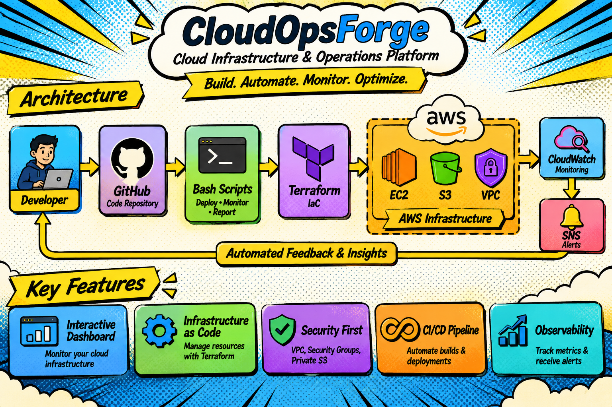

# CloudOpsForge

### Cloud Infrastructure & Operations Platform

Build. Automate. Monitor. Optimize.

CloudOpsForge is a cloud operations platform designed to demonstrate AWS infrastructure provisioning, automation, monitoring concepts, and DevOps practices through an interactive dashboard.

## Dashboard Preview

  

## Architecture



```text
Developer
    |
    v
  GitHub
    |
    v
Bash Automation Scripts
    |
    v
  Terraform
    |
    v
 AWS Infrastructure
    |
    v
CloudWatch + SNS
```

## Key Features

## Key Features

- **Interactive Dashboard:** Visual overview of cloud operations with sample infrastructure metrics.
- **AWS Infrastructure as Code:** Terraform configuration for provisioning AWS resources.
- **Network Architecture:** VPC, public subnet, Internet Gateway, security groups, and EC2 configuration.
- **Secure Storage:** Private Amazon S3 bucket configuration.
- **Bash Automation:** Scripts for deployment, infrastructure monitoring, cost reporting, and resource cleanup.
- **Continuous Integration:** GitHub Actions workflow for automated frontend builds and Terraform validation.
- **Infrastructure Documentation:** Architecture diagrams, project structure, and deployment guidance.
- **Cost Awareness:** Demonstration of cloud cost reporting and infrastructure management concepts.

## Technology Stack

| Technology | Purpose |
|---|---|
| React + TypeScript | Frontend dashboard |
| Tailwind CSS | User interface styling |
| AWS | Target cloud platform |
| Terraform | Infrastructure as Code |
| Bash | Automation scripts |
| GitHub Actions | Continuous Integration |

## Project Structure

```text
CloudOpsForge/
├── .github/
│   └── workflows/
│       └── ci.yml
├── public/
├── scripts/
│   ├── deploy.sh
│   ├── monitor.sh
│   ├── cost-report.sh
│   └── destroy.sh
├── src/
│   ├── components/
│   ├── data/
│   ├── pages/
│   └── types/
├── terraform/
│   ├── provider.tf
│   ├── variables.tf
│   ├── vpc.tf
│   ├── internet.tf
│   ├── security.tf
│   ├── ec2.tf
│   ├── s3.tf
│   └── outputs.tf
└── README.md
```

## Run Locally

### Prerequisites

- Node.js
- npm
- Git

### Installation

```bash
git clone https://github.com/Tamilmani99/CloudOpsForge.git
cd CloudOpsForge
npm install
npm run dev
```

Open the local URL displayed in your terminal.

### Build

```bash
npm run build
```

## Terraform Validation

Terraform configuration is available in the `terraform/` directory.

```bash
cd terraform
terraform init
terraform fmt
terraform validate
```

An AWS account and valid AWS credentials are required for planning or deploying AWS resources.

## CI Pipeline

GitHub Actions automatically:

- Installs frontend dependencies.
- Builds the React application.
- Checks Terraform formatting.
- Validates Terraform configuration.

## Current Project Status

- Frontend dashboard: Implemented with sample data.
- Terraform configuration: Written and validated.
- Bash automation scripts: Created.
- GitHub Actions CI: Passing.
- AWS infrastructure: Not yet deployed.
- Live AWS monitoring: Planned.

**Note:** This project currently uses demonstration metrics. The deployment interface is a frontend simulation; no AWS infrastructure has been created yet.

## Future Improvements

- Deploy infrastructure into AWS.
- Integrate CloudWatch monitoring and SNS alerts.
- Connect real infrastructure metrics.
- Implement secure automated deployment.
- Publish the frontend using GitHub Pages.

## Author

**Tamilmani**

GitHub: [Tamilmani99](https://github.com/Tamilmani99)